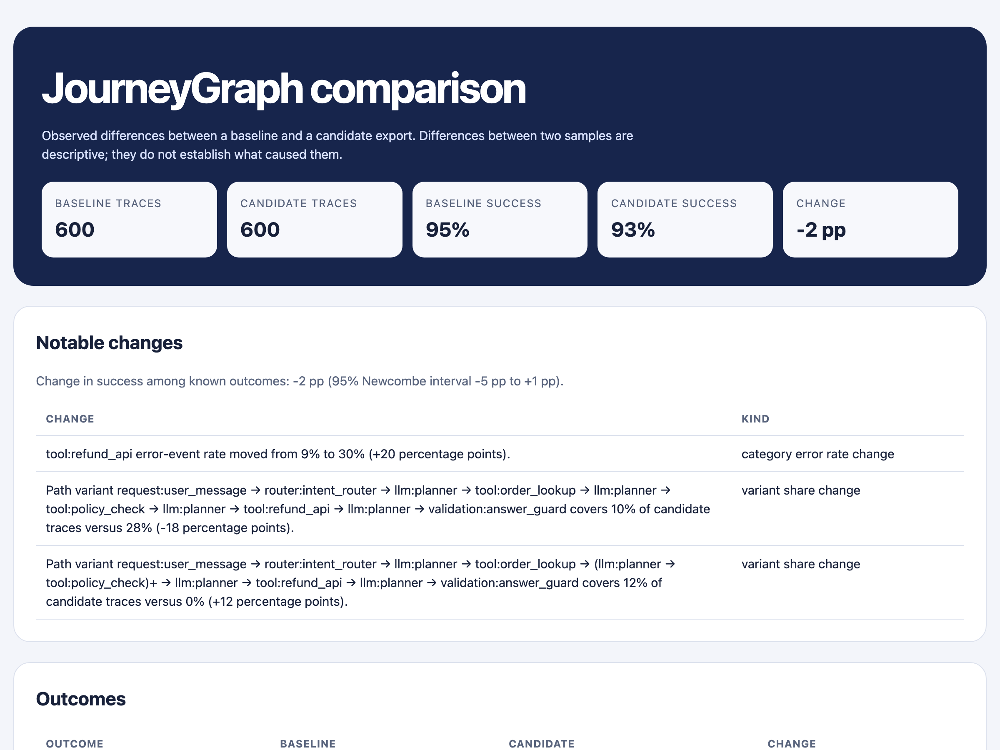
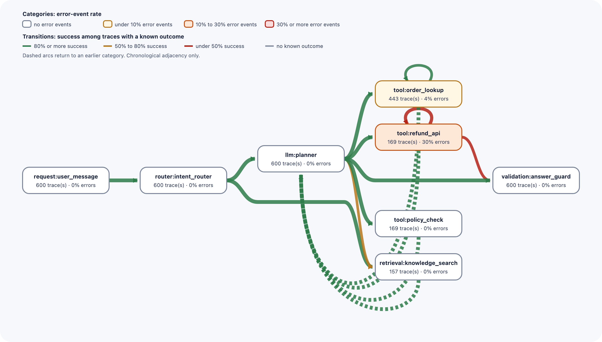

*A reproducible experiment on why aggregate metrics can miss agent regressions, and what analyzing traces across the whole dataset reveals instead.*

When releasing a new version of an agent, teams typically review a dashboard showing
metrics such as success rate, mean cost, and p95 latency. If these numbers are similar to
the previous week's, the release is considered acceptable.

I tested how well this approach detects a regression I intentionally introduced. The
results were unsatisfactory, and the reason is worth examining.

## Experiment setup

I developed a small, seeded simulator for a customer-support agent. Each run produces a
trace that includes a router, LLM planner calls, retrieval, tool calls, and a final guard.
The simulator supports three intents: order status (45% of traffic), refunds (30%), and
product questions (25%).

I then created a second version with one intentional fault in the refund flow, which shows
up in two ways:

- the planner repeatedly checks the refund policy, adding one or two extra rounds;
- the refund API times out more often, and retries often fail.

Both versions generate 600 traces. This synthetic data has a known outcome, which is
intentional: I know exactly what failed, so I can evaluate what each method detects.

## Dashboard results

| Metric | Baseline | Candidate |
|---|---|---|
| Success rate | 94.8% | 92.8% |
| Mean cost per trace | $0.0168 | $0.0181 (+7.5%) |
| Error events | 0.6% | 1.8% |

Success rate dropped by two points. With 600 traces per version, the 95% confidence
interval for this difference ranges from −4.8 to +0.7 points. Since this interval includes
zero, a careful reviewer would consider the change noise. By the numbers, they would be
right to.

Cost increased by 7.5%, which most teams would not consider a release blocker.

The regression is real and large, but it is not visible in these metrics: refunds account
for only 30% of traffic, and most refund runs still succeed after a retry. The average
masks the issue.

## Path analysis results

I analyzed both exports using [JourneyGraph](https://github.com/GermanGerken/journeygraph),
an open-source tool I maintain. It does not collect traces: it reads existing exports,
aggregates them into a single graph of steps and transitions, and then compares two such
graphs.

```bash
pipx install journeygraph
journeygraph diff baseline.jsonl candidate.jsonl --output-dir diff
```

The first three reported changes are as follows (step labels are shortened for clarity):

```
change: tool:refund_api error-event rate moved from 9% to 30% (+20 percentage points).
change: Path variant request → router → planner → order_lookup → planner → policy_check
        → planner → refund_api → planner → answer_guard covers 10% of candidate traces
        versus 28% (-18 percentage points).
change: Path variant … → (llm:planner → tool:policy_check)+ → … covers 12% of candidate
        traces versus 0% (+12 percentage points).
```



Both symptoms of the planted fault are identified, and in the order I would want to read
them:

1. **One tool's error rate tripled**, from 9% to 30% (62 of 210 calls).
2. **The main refund path decreased** from 28% of all traces to 10%.
3. **A new looped path appeared.** The `(planner → policy_check)+` notation indicates that
   this pair repeats. This path now covers 12% of traces and did not exist previously.

The single-version report for the candidate provides supporting counts: traces with a
repeated `refund_api` call increased from 9 to 41, and the
`policy_check → planner → policy_check` loop appears in 91 traces compared to zero
previously.



## Why the two perspectives differ

Success rate is a single value per trace, averaged across all traces. A regression limited
to one intent and partially masked by retries has minimal impact on this metric.

A path represents a structural change. For example, "this sequence of steps did not exist
last week and now covers 12% of runs" is not averaged away. Similarly, a per-step error
rate isn't diluted, since its denominator is the number of calls to that step rather than
all traffic.

Trace viewers such as Langfuse, Phoenix, or LangSmith are built to inspect individual
traces in detail, and they are good at it. The relevant question here is different: what
patterns emerge across 600 runs, and how have these patterns changed between versions?
Answering it requires aggregation across traces before using a viewer.

## Integrating into CI

The same comparison can be used to gate a pipeline:

```toml
# rules.toml
[regressions]
max_success_rate_drop = 0.03
max_error_event_rate_increase = 0.01
max_mean_cost_per_trace_increase = 0.15
forbid_new_categories = true
```

```bash
journeygraph check candidate.jsonl --rules rules.toml --baseline baseline.jsonl
```

```
PASS max_success_rate_drop: success among known outcomes dropped by 0.02 (limit 0.03)
FAIL max_error_event_rate_increase: error-event rate increased by 0.0119583 (limit 0.01)
PASS max_mean_cost_per_trace_increase: mean cost per trace increased by (relative) 0.0747896 (limit 0.15)
check: 5 of 6 rule(s) passed        # exit code 5
```

The build fails, which is the correct outcome. However, the margin is narrow: it failed one
global rule by 0.002. With a slightly higher threshold, this regression would have passed.
Global thresholds have the same averaging limitations as the dashboard. Rules scoped to a
single step or a single cohort are the next thing I am building, and this experiment is
the reason.

## Limitations

- **The data is simulated.** It demonstrates that the method can detect a known, planted
  fault. It does not indicate how often real regressions resemble this scenario.
- **Associations do not imply causation.** The report states "traces that include X had a
  lower success rate". It does not claim that X caused the failure.
- **Clear step names are important.** This simulation uses eight step types. A raw
  OpenTelemetry export from a microservice system contains dozens of low-level spans per
  trace, which can make the graph noisy. Improved grouping for such cases is in progress.
- **Scalability.** On my laptop, processing 240,000 events takes 16 seconds and uses about
  830 MB of memory. Growth is linear, so one million events would need an estimated
  3.5 GB. I have not measured that yet; I plan to benchmark larger datasets and will
  update this post with the results.

## Reproducing the experiment

The simulator, the rules file, and the expected output are in
[examples/agent-regression](https://github.com/GermanGerken/journeygraph/tree/main/examples/agent-regression).

```bash
python simulate_agent.py baseline baseline.jsonl
python simulate_agent.py candidate candidate.jsonl
journeygraph diff baseline.jsonl candidate.jsonl --output-dir diff
```

JourneyGraph is Apache-2.0, runs locally, has no runtime dependencies, and sends no
telemetry. It reads JSONL, CSV, Parquet, and OTLP exports, with field mappings for
Langfuse, Phoenix, and LangSmith exports.

If you run it on your own traces and the report is inaccurate or unhelpful, I welcome your
feedback: please [open a GitHub issue](https://github.com/GermanGerken/journeygraph/issues).
